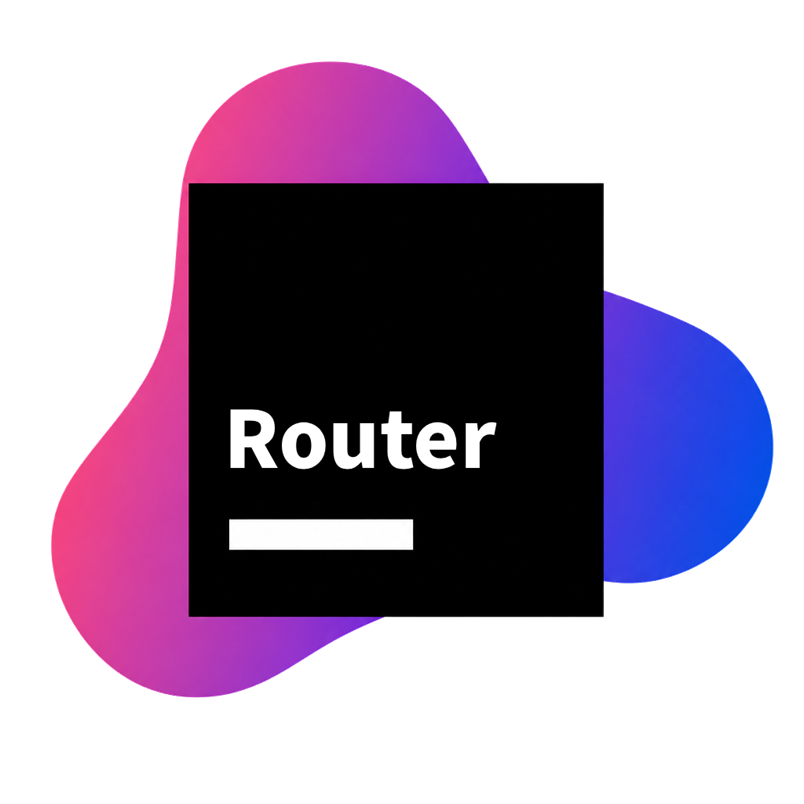
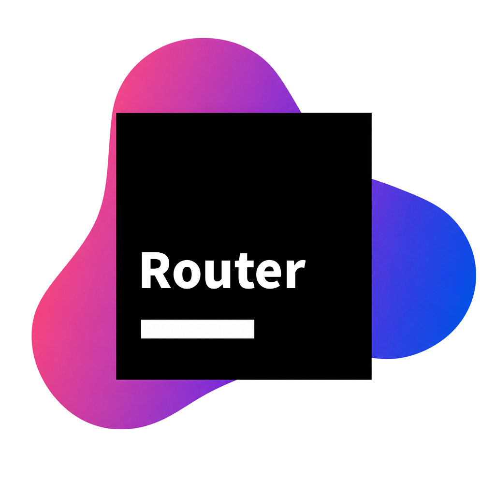
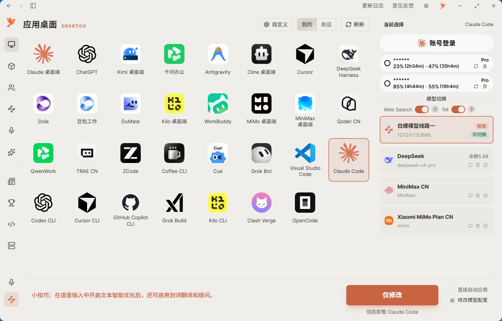
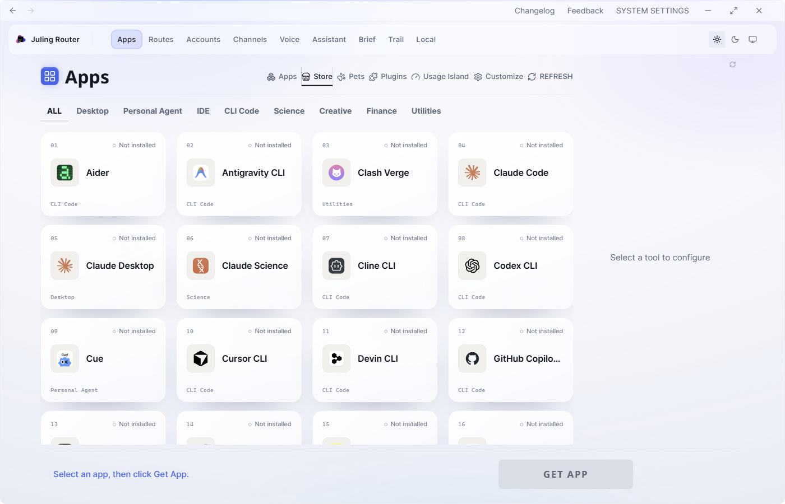
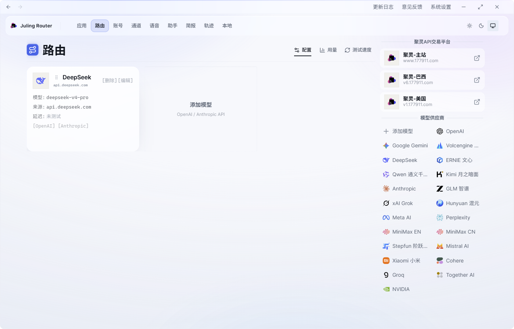
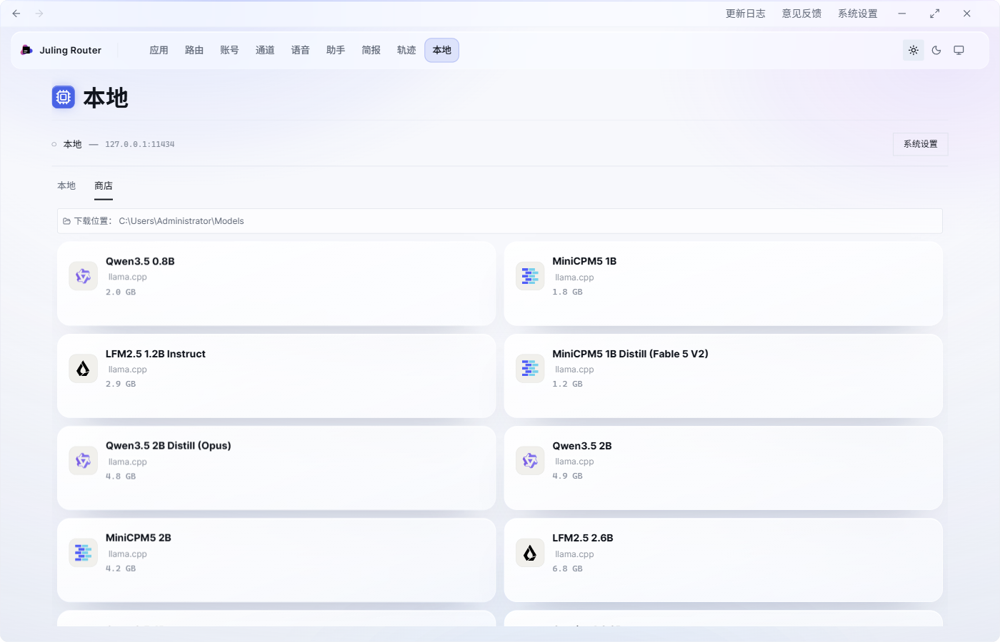
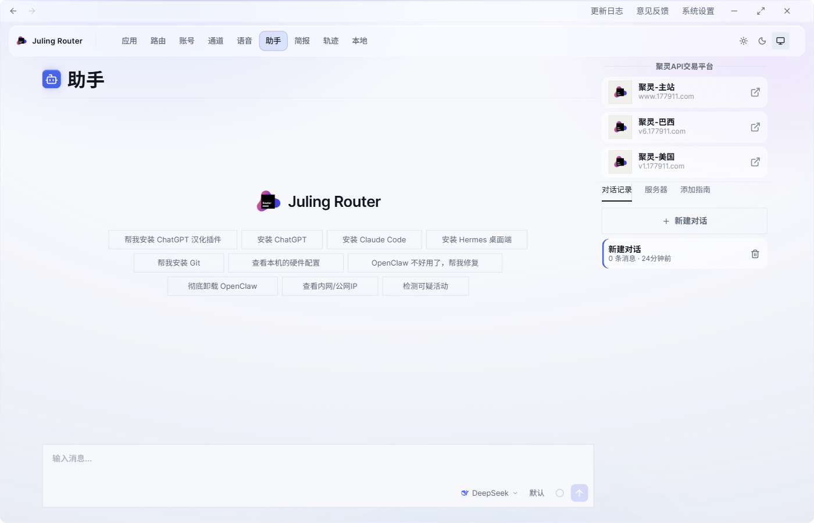
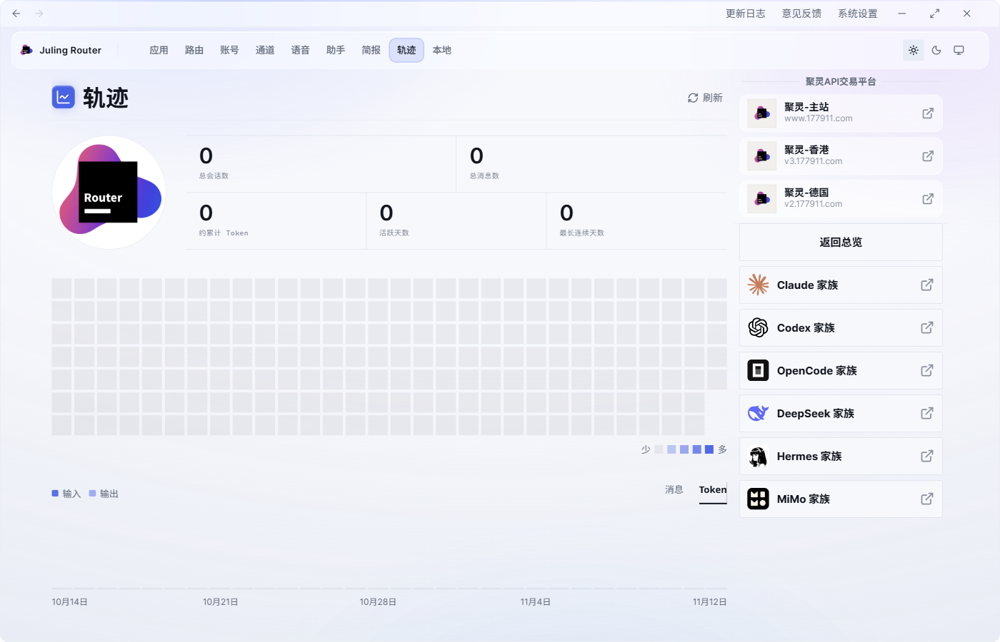

<p align="center">
  
</p>

<h1 align="center">Juling Router</h1>

<p align="center">一站式 AI 桌面应用：一键安装 Claude Code、Codex CLI、DeepSeek 等工具，管理 AI 账号与额度，多模型智能路由并自动故障切换，支持语音输入和运行本地大模型。彩蛋：一只随你使用 AI 而成长的 Token 宠物。</p>

<p align="center">
  <a href="https://github.com/177911-juling/Juling-Router/releases">
    
  </a>
  
  
  
</p>

<p align="center">
  <a href="https://www.177911.com">官网</a> ·
  <a href="https://github.com/177911-juling/Juling-Router/releases/latest">下载</a> ·
  <a href="https://www.177911.com/support/">☕ 请喝咖啡</a> ·
  <a href="README.md">English README</a>
</p>

> **说明** —— 本仓库仅为下载渠道与 issue 反馈渠道之一,产品信息、
> 公告、商业询价请访问 [www.177911.com](https://www.177911.com)。

---

## 💜 赞助商

<table>
  <tr>
    <td width="150" align="center">
      
    </td>
    <td>
      <a href="https://www.177911.com"><strong>聚灵API交易平台</strong></a> —— 模型 API 交易平台<br/>
      感谢 <strong>聚灵API交易平台</strong> 赞助了本项目！一个 API Key 即可让应用商店里的工具接入模型中心收录的模型，免去多账号切换。与聚灵路由器同一团队维护。
    </td>
  </tr>
</table>

赞助联系：[hi@177911.com](mailto:hi@177911.com)

---

## 这是什么

很多朋友让我帮他们安装 **Claude Code**、**OpenClaw**、**Hermes Agent**……不但每个人的系统都不一样,甚至有些人还抠门到不愿花钱买大模型,安装和解释起来都特别费劲。于是我开发了这个叫「Juling Router」的 Agent —— 灵感来自《赛博朋克 2077》里那位聪慧过人、总能帮主角搞定一切技术难题的天才女助理 **Songbird**…

<table>
  <tr>
    <td align="center" width="50%">
      <a href="docs/screenshots/desktop-cn-light.png">
        <picture>
          <source media="(prefers-color-scheme: dark)" srcset="docs/screenshots/desktop-cn-dark.png">
          
        </picture>
      </a>
      <br><sub>中文</sub>
    </td>
    <td align="center" width="50%">
      <a href="docs/screenshots/desktop-en-light.png">
        <picture>
          <source media="(prefers-color-scheme: dark)" srcset="docs/screenshots/desktop-en-dark.png">
          
        </picture>
      </a>
      <br><sub>English</sub>
    </td>
  </tr>
</table>

## 亮点

Juling Router 提供 **4 大场景**,共享一个 **模型数据中枢** —— **一处配置,四处生效**。

### 4 大场景

- **安装与修复** —— 让 AI 帮你安装与修复主流 AI 工具(Claude Code、OpenClaw、Hermes Agent 等);本地与远程都支持
- **一键本地大模型** —— 内置 vLLM / SGLang / llama.cpp 三引擎,选好量化版本按下 START 就能跑
- **插件 Hub（开发者预览）** —— 安装已审核的社区插件，或从仓库、本地目录添加自定义扩展
- **应用管理** —— 所有跟 AI / Agent 有关的应用或游戏一键启动与管理

### 共享地基

- **模型中心** —— 统一的模型数据中枢(OpenAI / Anthropic / 本地 LLM / API Router);一处配置好,4 大场景立即生效;附带一键测速,使用前看清真实延迟

**跨平台** —— Windows、macOS、Linux(x64 + arm64)

## 多账号切换 —— ChatGPT、Codex CLI、Claude Code

在 Juling Router 的**应用管理**中保存多个账号、查看使用额度，并选择启动工具时使用的账号。

- **ChatGPT 桌面版与 Codex CLI** —— 通过浏览器登录添加 OpenAI 账号，选中已保存账号后启动。这两个工具共享本地 Codex 账号配置，切换会影响共用的登录状态。
- **Claude Code** —— 通过浏览器授权添加账号，选择账号后启动 Claude Code；可查看套餐、5 小时与 7 天剩余额度及重置倒计时（以服务商返回的数据为准）。
- **额度一目了然** —— 在同一面板查看剩余额度和重置时间、刷新用量、删除已保存账号。

**开始使用：**打开「应用管理」→ 选择 ChatGPT、Codex CLI 或 Claude Code → 添加并授权账号 → 选中账号 → 启动。账号选择在启动时生效；需要使用第三方 API 时，改选对应的模型即可。

## 多模型智能路由 —— 按优先级调用，故障自动切换

Juling Router 的**智能路由（Smart Router）**用一个本地 API 汇总多个模型服务。把模型中心已配置的免费、付费或私有模型加入路由，拖动卡片设置优先级。模型限流、额度耗尽或临时不可用时，路由自动尝试下一个；冷却结束后，重新按优先级尝试。

- **最多接入 20 个模型** —— 复用已有模型配置，无需重复填写 API Key。
- **兼容工具共用一个入口** —— 支持 OpenAI Chat Completions 和 Anthropic Messages，可供 Claude Code 等兼容客户端使用。
- **优先级由你决定** —— 按你设定的顺序调用，不按任务内容或价格自动选模型。

**开始使用：**打开「智能路由」→ 从「我的模型」或免费模型目录添加模型 → 拖动排序 → 在「应用管理」中为兼容工具选择 **Auto Router**。工具通过本地 API 调用期间，请保持 Juling Router 运行。

智能路由切换的是已配置的模型 API，不会自动轮换已保存的登录账号。ChatGPT / Codex CLI 接入第三方模型需要 **Responses API**，当前智能路由尚未提供此接口；这两个工具请使用账号切换，或直接接入支持 Responses 的服务商。

[在官网了解多账号切换与智能路由](https://www.177911.com/#accounts-and-routing)。

## 支持的工具 —— 一键安装、一键切换模型

Juling Router 内置了各工具的安装脚本,**并直接写入每个工具的原生配置文件**,
所以你既能在一个地方装好,更关键的是能**一键切换模型**。在模型中心配好一处
provider,任意支持的工具都能指向它;不用手改 TOML / JSON,不用每个 CLI 重新
登录。这正是大部分「切换模型」开源仓要你自己折腾的部分。

### 一键安装 + 一键切换模型

以下工具**同时**支持安装与切换模型 —— 这是 Juling Router 的核心:

**编程 CLI** —— Claude Code · Codex CLI(OpenAI) · Grok Build(xAI) ·
Kimi CLI(月之暗面) · Qwen Code · Aider · OpenCode · MiMo Code(小米) · Kilo Code ·
ZCode(Z.AI) · OpenClaw · Pi · Vibe-Trading

**桌面应用** —— Claude Desktop(第三方 profile) · ChatGPT 桌面版 ·
Kimi 桌面端 · OpenCode Desktop · OpenScience · WorkBuddy(腾讯 CodeBuddy 办公版)

> 在 GitHub 上搜「给 Grok Build 切换模型」「给 Kimi CLI / 桌面端切换模型」?
> 这两个在这里都是一等公民 —— 在模型中心选好模型,按下切换,Juling Router
> 就帮你重写 `~/.grok/config.toml` 或 `~/.kimi-code/config.toml`。

### 一键安装与启动

这些工具由 Juling Router 检测、安装、管理,但模型切换由应用自身负责
(厂商锁定或无模型配置):

Hermes Desktop · Claude Science · Cursor · VS Code ·
Gemini Desktop · Coffee CLI

## 界面截图

### 模型中心 —— 模型数据中枢,一处配置,四处生效

<picture>
  <source media="(prefers-color-scheme: dark)" srcset="docs/screenshots/model-cn-dark.png">
  
</picture>

### 应用桌面 —— 所有 AI / Agent 应用一键启动与管理

<picture>
  <source media="(prefers-color-scheme: dark)" srcset="docs/screenshots/desktop-cn-dark.png">
  
</picture>

### 本地大模型 —— 在自己机器上跑

<picture>
  <source media="(prefers-color-scheme: dark)" srcset="docs/screenshots/localllm-cn-dark.png">
  
</picture>

### 安装与修复 —— 用对话搞定部署和排障

<picture>
  <source media="(prefers-color-scheme: dark)" srcset="docs/screenshots/agent-cn-dark.png">
  
</picture>

### 我的 AI 生涯 —— 仪表盘

<p align="center">
  <picture>
    <source media="(prefers-color-scheme: dark)" srcset="docs/screenshots/career-cn-dark.png">
    
  </picture>
</p>

## 安装

### 一行命令安装

**Windows**(PowerShell)

```powershell
irm https://www.177911.com/install.ps1 | iex
```

**macOS / Linux**

```sh
curl -fsSL https://www.177911.com/install.sh | sh
```

脚本会自动识别你的系统,下载对应的安装包,如果你已经是最新版会自动跳过。

### 或者下载安装包

最新版本 → <https://github.com/177911-juling/Juling-Router/releases/latest>

| 平台                        | 安装包                                 |
| --------------------------- | -------------------------------------- |
| Windows x64                 | `JulingRouter_<ver>_Windows_x64-setup.exe` |
| macOS(Apple Silicon)        | `JulingRouter_<ver>_macOS_arm64.dmg`       |
| Linux x64 · Debian/Ubuntu   | `JulingRouter_<ver>_Linux_x64.deb`         |
| Linux arm64 · Debian/Ubuntu | `JulingRouter_<ver>_Linux_arm64.deb`       |
| Linux x64 · Fedora/RHEL     | `JulingRouter_<ver>_Linux_x64.rpm`         |
| Linux arm64 · Fedora/RHEL   | `JulingRouter_<ver>_Linux_arm64.rpm`       |

## 协议与商标

**代码** —— Juling Router **v1.0.0** 采用
[Apache License 2.0](LICENSE) 协议。完整源码全部开放:随便 fork、研读、二次发布。
署名要求见
[NOTICE](NOTICE)。

**商业外观 + 品牌** —— Juling Router 的主防线是 **UI / UX 商业外观(trade dress)**:
四个用户面向界面共享同一个中央模型枢纽的具体组合,以及内置两个完整可运行的
参考应用(黑白棋 + AI 翻译)作为用户教程模板。**Juling Router** 是 177911-juling 的
单一普通法文字商标;_Model Nexus / 模型中心_ 等功能名是描述性标签,**不单独
主张为商标**,只作为 trade dress 的一部分受保护。**Fork 欢迎 —— 无需抹掉我们
的名字和 Logo**。如果你的 fork 在 README / About 页面 / 产品页诚实标注 Juling Router
为上游,可以保留我们的身份可见(例:"Juling Router 社区版 by X");完全重新品牌化
也可以,改名 + 替换 Logo,但 NOTICE 中保留致谢。硬底线有三条:**未授权的商业
SaaS / 应用商店产品字面挂 Juling Router**;**把代码当作你从零写的原创发布**;以及
**在没有独立先创证据的情况下,在一个竞争性产品中并列采用我们四个 UI 界面中的
三个或以上**(详见 [NOTICE](NOTICE) 阈值)。完整政策见 [TRADEMARKS.md](TRADEMARKS.md)。

---

<p align="center">
  Made with 💚 by Juling Router Team<br>
  <sub>⭐ <a href="https://github.com/177911-juling/Juling-Router">在 GitHub 上点个 Star</a> · <a href="README.md">English README</a></sub>
</p>
